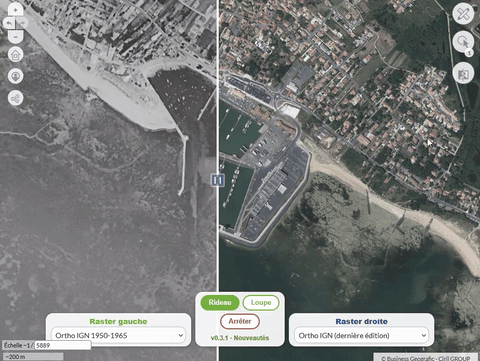

# geo-compare-swipe — Comparateur de rasters (rideau / loupe)



Module GEO qui compare deux rasters (orthophotos IGN, flux WMS/WMTS/XYZ de la collectivité…)
**directement sur la carte OpenLayers principale** de l'application, sans carte secondaire.
Il s'appuie sur [ol-ext](https://github.com/Viglino/ol-ext) (Jean-Marc Viglino) :

- **Rideau** : `ol.control.Swipe`, un curseur déplaçable sépare le raster de gauche et celui de droite.
- **Loupe** : `ol.interaction.Clip`, le raster de droite n'apparaît que dans un cercle qui suit la souris.

Inspiré du script communautaire « geo_swipe_control » (Malo Tartevet, Quimperlé Communauté,
licence Beerware, puis Pierre C du CD 07), réécrit sous forme de module.

## Réglages du Générateur

| Réglage | Rôle |
|---|---|
| Fonds de plan GEO à comparer | Glisser-déposer des fonds de plan déjà paramétrés dans GEO (Données → Fonds de plan) |
| Inclure le catalogue IGN | Orthos Géoplateforme : dernière édition, 2003 à 2021, historiques 1950-1980 (après les fonds GEO) |
| Inclure le catalogue CRAIG | Orthos du CRAIG et de ses partenaires (Auvergne-Rhône-Alpes : millésimes successifs, ortho historique 1948-1954, prises de vues locales), **lues dans le GetCapabilities du CRAIG** à l'ouverture du comparateur ; désactivé par défaut |
| Raster initial gauche / droite | Libellé (ou identifiant de catalogue) de départ de chaque côté ; par défaut les deux premiers fonds GEO choisis |
| **Emplacement des menus** | **« Sur la carte »** : bouton dans la barre d'outils et menus en bas de la carte. **« Panneau latéral »** : onglet de la barre latérale contenant les menus |
| Mode initial, rayon de la loupe | Rideau ou loupe au lancement ; rayon en pixels |
| Libellé, position du bouton | Bouton de la carte (position : emplacement « Sur la carte » seulement) |

### Fonds de plan GEO

Les fonds choisis sont reconstruits côté navigateur depuis leur descripteur GEO
(`geoApplication._baseLayers`) : WMTS (via GetCapabilities), WMS (y compris proxifié), XYZ/TMS.
Le GetCapabilities WMTS est soumis à CORS : un serveur qui ne renvoie pas les en-têtes CORS
fera échouer le chargement (un message l'indique et la console détaille la cause).

## Fonctionnement

Les deux rasters sont ajoutés à la carte principale avec un `zIndex` de 998 (gauche) et 999 (droite) :
au-dessus des fonds de plan GEO, **sous** les couches thématiques, qui restent visibles par-dessus.
Arrêter la comparaison retire le contrôle, l'interaction, les couches et le contour de la loupe.

ol-ext est embarqué dans le bundle (version figée) et complète le `ol` global fourni par GEO.

## Journal des nouveautés

`CHANGELOG.md` (Keep a Changelog, en français, pour les utilisateurs) est embarqué dans le module : le lien « v… · Nouveautés » (sous le bouton « Arrêter » de la barre
de comparaison, ou en bas du panneau latéral) ouvre une fenêtre qui le montre, avec un point rouge tant que la dernière version n'a pas été lue. Les fichiers
`src/js/changelog.js`, `scripts/check-version.js` et `test/changelog.test.mjs` sont copiés du gabarit du dépôt d'origine (ne pas les modifier ici). `npm test` et
`npm run package` vérifient que `package.json`, `src/plugin.geoext.json` et le premier `## [x.y.z]` du journal portent la même version : les trois s'écrivent dans le même commit.

## Développement

```bash
npm install
npm run build     # dist/main.js
npm run package   # build + geo-compare-swipe.zip (import dans le Générateur)
```

## Points d'attention

- La v1.0.0 (catalogue IGN + JSON) a été validée sur un serveur GEO ; **les fonds de plan GEO (v1.1.0) restent à valider** (WMTS via GetCapabilities, WMS proxifié).
- Emplacement « Panneau latéral » selon le gabarit (`gp3` n'a pas de panneau latéral).
- Couverture des orthos IGN annuelles : une année non prise sur le territoire s'affiche en blanc.

## Licence

- **Code** : [GPL-3.0-or-later](LICENSE) — © 2026 Vienne Condrieu Agglomération.
- **Documentation** (ce README, `CHANGELOG.md`, captures) : [CC-BY-4.0](LICENSE-DOCS).
- **Composants tiers** embarqués dans le bundle (ol-ext) : voir [THIRD-PARTY-LICENSES.md](THIRD-PARTY-LICENSES.md).
- **Marques** : « GEO » et « Business Geografic » sont des marques de leurs titulaires ; ce module est indépendant et
  n'est ni édité ni approuvé par Business Geografic.
- **Plugin propriétaire non inclus** : `npm run publish` utilise `@bg/publish-js-extension` (Business Geografic), qui n'est
  pas distribué avec ce dépôt. Il n'est pas nécessaire pour `npm run build` ni `npm run package`.

Les contributions se font sous la même licence, avec signature DCO : voir [CONTRIBUTING.md](CONTRIBUTING.md).
